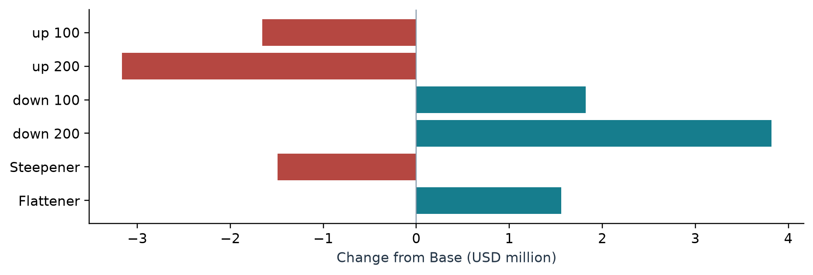
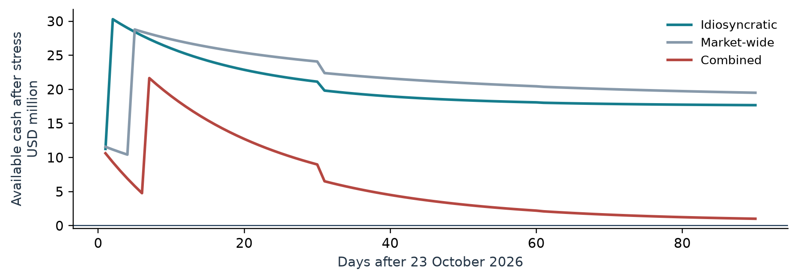

# Bank ALM / IRRBB & Liquidity Stress Testing

Portfolio-grade asset-liability management analysis of a **USD 100 million synthetic banking book**, combining Python cash-flow modelling, DuckDB reconciliations, an Excel management pack and a nine-page recruitment portfolio case study.

| Portfolio result | Base / worst case |
| --- | ---: |
| 12-month base NII | USD 2.568m |
| Worst NII shock | USD -32.2k under +200 bps |
| Worst EVE shock | USD -3.167m under +200 bps |
| Combined liquidity stress | ≥90 days; USD 1.017m closing buffer |



## What this project answers

- How does a calibrated banking book reprice across short- and long-term buckets?
- Which interest-rate shocks create the largest earnings and economic-value losses?
- How do deposit beta and non-maturity-deposit assumptions change NII sensitivity?
- Can the book fund 90 days of idiosyncratic, market-wide and combined liquidity stress?
- Can the headline results be reconciled independently enough to support management review?

## What I built

- A deterministic **938-record** synthetic balance sheet calibrated to Federal Reserve H.8 aggregates and a frozen US Treasury curve.
- Contract-level cash-flow projection for fixed, floating and amortizing positions, with scenario NII and full-life EVE valuation.
- A daily liquidity ledger with runoff, commitment draws, funding nonrenewal, haircuts, asset monetization and an internal inflow cap.
- Four executed DuckDB control queries covering balance sheet, repricing, scenario aggregation and liquidity reconstruction.
- A recruiter-ready delivery layer: [PDF portfolio report](report/Banking_Book_Interest_Rate_and_Liquidity_Stress_Testing_Report.pdf), [Word portfolio report](report/Banking_Book_Interest_Rate_and_Liquidity_Stress_Testing_Report.docx) and [Excel management pack](outputs/Bank_Treasury_Risk_Management_Pack.xlsx).

## Selected findings

The book has a **USD -46.42m** overnight-to-one-month repricing gap, while **USD 42.15m** of assets sit beyond five years with no corresponding rate-sensitive liabilities in that bucket. The default +200 bps shock therefore produces the largest EVE decline: **USD -3.167m**, or **-33.62%** of the stylized equity residual proxy.

The same +200 bps shock reduces 12-month NII by only **USD 32.2k** under the default behavioral assumptions. That result is deliberately paired with non-maturity-deposit sensitivity, because changing deposit beta can reverse the earnings direction.

All three liquidity scenarios remain above zero through day 90. The result is right-censored: it means survival is **at least 90 days**, not that the model estimates an eventual failure date.



## Methodology at a glance

1. Freeze and validate the Treasury and Federal Reserve source snapshots against a versioned source lock.
2. Calibrate a USD 100m synthetic banking book while separating observed public totals from model assumptions.
3. Project contractual cash flows under base, parallel, steepener and flattener scenarios.
4. Calculate repricing gaps, 12-month NII, full-life EVE and 90-day liquidity stress.
5. Reconcile outputs through Python controls, DuckDB queries, artifact checks and saved-report verification.

The SQL layer contains two independent recomputations—balance sheet and repricing—and three partial recomputations that reuse projected cash flows or discount inputs. It is a control framework, not a claim of a second independent valuation engine. See [methodology and model boundaries](docs/methodology.md) for formulas and assumptions.

## Validation

The packaged release preserves the independently reviewed technical baseline:

- **64 / 64** pytest cases passed with no failures, errors or skips.
- **52 / 52** automated acceptance controls and **2 / 2** recorded visual reviews passed.
- **30 / 30** core dataset and model controls passed.
- **17 / 17** current-metric reconciliations passed.
- Python-to-SQL maximum difference was **USD 0.0000008158**, below the USD 0.01 tolerance.
- The Word report is exactly nine pages; the Excel pack contains 12 sheets, 15 native tables, four native charts and 88 cached formulas with no external links or formula errors.

Read the concise [validation summary](docs/validation.md) or the detailed [QA report](qa/QA_REPORT.md). Machine-readable evidence is available in [qa/checks.json](qa/checks.json), [qa/core_checks.json](qa/core_checks.json) and [qa/current_metric_reconciliation.csv](qa/current_metric_reconciliation.csv).

## Repository guide

```text
config/             versioned public-source lock
data/raw/           frozen official source observations
data/processed/     compact reproducibility inputs and position ledger
docs/               methodology and validation notes
outputs/             reviewed tables, figures, metrics and Excel pack
report/              PDF and Word portfolio case study
sql/                 executed reconciliation queries
src/                 analytics, controls and artifact builders
tests/               engine, artifact, regression and source-boundary tests
qa/                  concise public acceptance evidence
```

Large generated intermediates—the DuckDB database, full cash-flow Parquet and artifact payload—are intentionally not versioned. The documented pipeline regenerates them locally.

## Reproduce locally

Python 3.12 is the verified runtime. From the repository root:

```bash
python3 -m venv .venv
source .venv/bin/activate
python -m pip install -r requirements.txt
python -m src.source_validation
python -m src.public_data
python -m src.pipeline
python -m src.figures
python -m src.prepare_artifacts
python -m src.build_report
python -m src.render_report
python -m src.artifact_validation
python -m pytest -q
```

`src.source_validation` is fail-closed: it checks source hashes, dates, schemas, units and raw-to-processed lineage before analysis writes. PDF rendering requires LibreOffice and Poppler on `PATH`. The published Excel pack was built and verified with the repository's JavaScript builders plus `@oai/artifact-tool`; its saved formulas and structure are covered by artifact validation.

## Data and licensing

The model uses official US Treasury and Federal Reserve Board observations with attribution. Frozen source dates, hashes, transformations and redistribution notes are documented in [DATA_SOURCES.md](DATA_SOURCES.md). Project code is available under the [MIT License](LICENSE). No seals, logos, personal data or real-bank records are included.

## Scope and limitations

This is a synthetic portfolio study, not a production model or an analysis of a real bank. It does not calculate regulatory LCR/NSFR, trading-book VaR or a BCBS standardized supervisory outlier test. The equity residual is a balancing proxy, not regulatory capital. The model omits prepayment, default, optionality, hedges, basis/credit-spread/FX risk, exact payment calendars, margin calls and several operational liquidity effects. Behavioral deposits, sub-product mixes, runoff rates and haircuts are documented assumptions rather than estimates from bank-level data.
